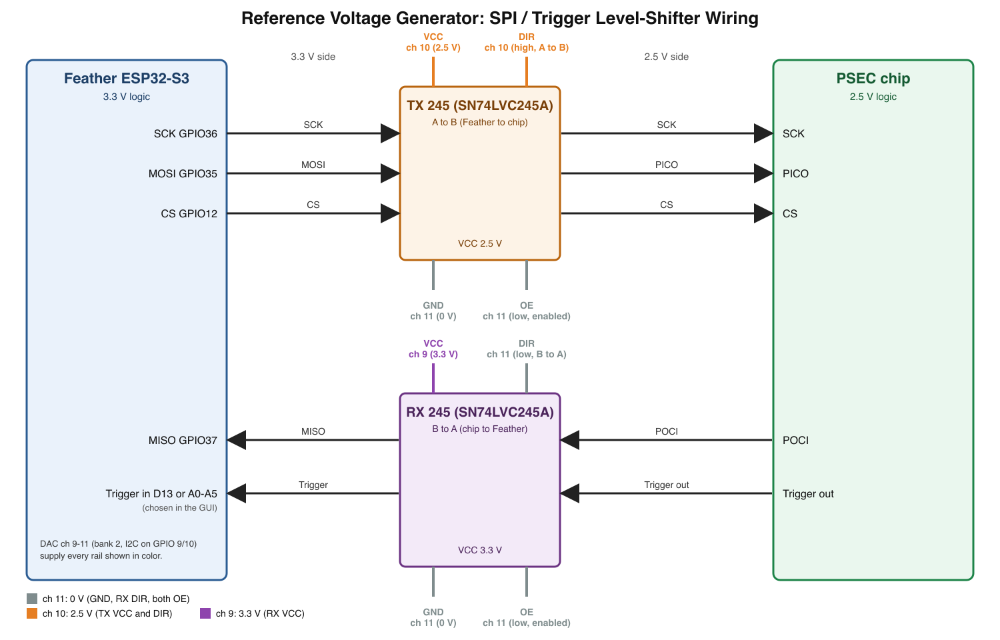

# Reference Voltage Generator
- [Initiating Serial Communication](#initiating-serial-communication)
- [Entering Voltage Values](#entering-voltage-values)
- [SPI Communication](#spi-communication)
- [How to Run the GUI on Windows](#how-to-run-the-gui-on-windows)
- [How to Compile Natively on Linux](#how-to-compile-natively-on-linux)
- [How to Cross-Compile on Linux](#how-to-cross-compile-on-linux)
- [How to Upload Sketch to Adafruit Feather](#how-to-upload-sketch-to-adafruit-feather)
- [How to Upload Sketch to Arduino Nano](#how-to-upload-sketch-to-arduino-nano)
- [How to Wire Feather to Nano](#how-to-wire-feather-to-nano)
- [Setting Up GUI v2.0 on a New Computer](#setting-up-gui-v20-on-a-new-computer)
- [GUI v2.0: Level Shifters, Trigger Out and POCI Read-back](#gui-v20-level-shifters-trigger-out-and-poci-read-back)
- [Known Issues](#known-issues)

Reference Voltage Generator is a set of programs in which a user can enter voltage values to a graphical user interface (GUI) and a microcontroller responds to GUI events by sending those voltage values to digital-to-analog converters (DACs). The GUI application in Figure 1 was developed on Linux in C using GTK4. It can be cross-compiled to Windows using Linux as the host machine. The precompiled Windows executable is also available. The GUI was designed to communicate with an Adafruit Feather ESP32-S3 Reverse TFT. The Feather application parses commands received from the GUI and determines if the command intends to send a voltage value to one of the DACs via I2C, or if the command is meant to send bytes to another microcontroller via SPI.


*Figure 1. Graphical user interface.*

## Initiating Serial Communication
[Jump to Top](#reference-voltage-generator)


*Figure 2. Dropdown menus for COM port, baud rate, and initiating connection.*

The user begins by selecting a serial communication port from the COM Port dropdown menu in Figure 2. In GUI v2.0 the list shows the serial ports actually plugged in (any COM number on Windows, `/dev/ttyACM*`/`/dev/ttyUSB*` on Linux, `/dev/cu.usbmodem*` on macOS), the Feather is listed first and connected automatically if it is the only one found, and the Refresh button rescans after you plug a board in. In GUI v1.0 the listed ports are COM1–8, USB0–1, and ACM0. Users on Windows operating systems should select from COM1–8. Users on other operating systems should select from USB0–1 or ACM0. Command-line utilities such as lsusb on Linux may help the user figure out which serial communication ports are available on their computer and which particular port their target device (e.g. a microcontroller) is connected to.

The user can also select a baud rate from the next dropdown menu. Available baud rates are 1200, 2400, 4800, 9600,19200, 38400, 57600, 115200, 230400, 460800, and 921600. The user should select the appropriate baud rate for their target device by reading their device’s datasheet.

After the user selects a COM Port and Baud Rate and clicks the Connect button, the application will attempt to connect to the target device with the selected settings. The user should troubleshoot by verifying that their COM Port and Baud Rate selections are correct, disconnecting and reconnecting their device to the port, and checking if their cable is “charge-only.” A cable designed only for charging battery is not the same as a cable meant for data transfer, which is the type of cable required for serial communication.

## Entering Voltage Values
[Jump to Top](#reference-voltage-generator)

The user can enter values for twelve channels, numbered Channels 0–11. Figure 3 shows Channels 0–1. The user can enter voltage values within the range of 0.0000 to 5.0000 volts. If the user tries to enter an out-of-bounds value, it will automatically be clamped within range. A value of –1 will be forced to 0 and a value of 5.9999 will be forced to 5.0000. The value can be increased or decreased by 100 microvolts at a time by clicking the Arrow-Up and Arrow-Down buttons next to the corresponding voltage entry.


*Figure 3. Channels 0-1.*

Figure 3 also shows ON/OFF and UPDATE buttons. The ON/OFF button is a two-state toggle that begins in state OFF. When the OFF state is toggled, the application sends a command to power off the corresponding DAC (e.g. Toggling Channel 0 OFF will power off DAC 0). When UPDATE is clicked, the application sends a command to the Feather containing the DAC number and voltage value, and the Feather applies the voltage value to the right DAC. When the ON state is toggled, the application sends a command to power on the same DAC with the last voltage value that was written to it.


*Figure 4. All OFF/ON/UPDATE buttons below Channel 11.*

In Figure 4, below Channel 11, there are three buttons, All OFF, All ON, and All UPDATE. The first toggles the OFF state for each ON/OFF button and the second toggles the ON state. The application sends one command at a time to power off each DAC, starting from DAC 0.

## SPI Communication
[Jump to Top](#reference-voltage-generator)

In Figure 5, the user can enter three bytes of data in hexadecimal format. They can choose to send the first byte, the first and second byte, or all three bytes. The application was tested to send user-inputted bytes through the Feather to an Arduino Nano via SPI. It was also tested to receive bytes from the Nano, through the Feather, and display the received bytes on the application window. The text will read “Nothing received” until bytes arrive at the Feather’s serial port from the Nano.


*Figure 5. SPI section of the GUI where the user can send bytes and view received bytes.*

### How to Run the GUI on Windows
[Jump to Top](#reference-voltage-generator)

Clone the repository and enter the `windows_app` directory. This directory contains DLLs (Dynamic-Link Libraries) that the Windows executable requires. 
```
git clone https://github.com/scguerrero/ReferenceVoltageGenerator.git
cd ReferenceVoltageGenerator/windows_app
```
Open this directory in your file manager and double-click the executable ReferenceVoltageGenerator.exe.

### How to Compile Natively on Linux
[Jump to Top](#reference-voltage-generator)

Clone the repository, open it, compile `main.c`, and run it with `./main`.
```
git clone https://github.com/scguerrero/ReferenceVoltageGenerator.git
cd ReferenceVoltageGenerator
gcc $(pkg-config --cflags gtk4) -o main main.c $(pkg-config --libs gtk4) -lm
./main
```

### How to Cross-Compile on Linux
[Jump to Top](#reference-voltage-generator)

Install [quasi-msys2](https://github.com/HolyBlackCat/quasi-msys2) according to the instructions for your Linux distribution in the [Usage](https://github.com/HolyBlackCat/quasi-msys2#usage) section.

When the installation is complete, enter the `quasi-msys2` directory. Open the shell and compile `main.c` inside the environment.

```
env/shell.sh # Open the shell

# Cross-compile the executable named ReferenceVoltageGenerator.exe
x86_64-w64-mingw32-gcc main.c -o ReferenceVoltageGenerator.exe `pkg-config --cflags --libs gtk4` -lm

ls # Check that the exe was created by looking at the list of files
exit # Close the shell
```

Create a new directory, *not* inside `quasi-msys2`, called `windows_app` (any name will work as long as it indicates that it's for Windows). Copy the Windows executable you just created to this new directory. Copy the Windows DLLs (Dynamic-Link Libraries) to this new directory as well.

```
# In a different directory that isn't quasi-msys2
mkdir windows_app

# Copy the exe to the new directory
# IMPORTANT: Adjust path to where your quasi-msys2 directory is located on your computer
cp /path/to/quasi-msys2/ReferenceVoltageGenerator.exe /path/to/windows_app/

# Copy the DLLs to the new directory
cp -r /path/to/quasi-msys2/root/ucrt64/bin/ /path/to/windows_app/
```

To test the Windows executable on Linux, use Wine to run it.

```
cd windows_app

# Set Wine display and language settings to avoid seeing corrupted fonts in the GUI
PANGOCAIRO_BACKEND=fc LANG=en_US.UTF-8 WINEPATH="bin/" wine ReferenceVoltageGenerator.exe
```

If it runs with readable fonts, then it is safe to run natively on Windows. Always run the Windows executable inside the folder with the DLLs. It will fail to execute if it does not have access to them. The author is aware of this issue and will update this section when she solves it.

### How to Upload Sketch to Adafruit Feather
[Jump to Top](#reference-voltage-generator)

The GUI is designed to communicate with an Adafruit Feather ESP32-S3 Reverse TFT. Uploading Arduino sketches to the Feather through Arduino IDE is error-prone on Ubuntu Linux, so this project uses [esptool](https://github.com/espressif/esptool) to upload Arduino sketches to the Feather on the command line. Windows users likely will not encounter this issue and can use Arduino IDE to upload sketches to the Feather as normal. 

Arduino IDE can still be used to write/edit sketches for the Feather. Open the file `esp32_voltage_generator.ino` with Arduino IDE and, if applicable, allow the IDE to automatically place the `.ino` inside of a new folder. Choose the Feather in the board/port dropdown menu next to the Verify/Upload/Debug circle icons. Click Verify to check for syntax errors. Next, in the top ribbon toolbar, click Sketch > Export Compiled Binary. This will generate binary files that can be flashed to the Feather.

Open the folder containing the `.ino` file. It will contain a new subdirectory called `build/esp32.esp32.adafruit_feather_esp32s3_reversetft`. Open that subdirectory. Use `ls` to check for the following files:
```
esp32_voltage_generator.ino.bootloader.bin
esp32_voltage_generator.ino.partitions.bin
esp32_voltage_generator.ino.bin
```
These will be flashed to the Feather using esptool.

Before flashing, put the Feather in ROM bootloader mode by holding the D0 button, clicking the Reset button on the TFT side (still holding D0), then releasing D0. Check that the Feather is bootloader mode by running `lsusb`. If `lsusb` shows a device with the name `Espressif`, then it is ready for flashing. If the device says `Adafruit`, try again before proceeding.

After confirming that the Feather is in ROM bootloader mode, use esptool to flash the three files listed above to the board.
```
# Try this first
esptool --chip esp32s3 --port /dev/ttyACM0 --baud 921600 write_flash -z \
  0x0 esp32_voltage_generator.ino.bootloader.bin \
  0x8000 esp32_voltage_generator.ino.partitions.bin \
  0x10000 esp32_voltage_generator.ino.bin
  
# If esptool does not work, try this path instead
~/.local/bin/esptool.py --chip esp32s3 --port /dev/ttyACM0 --baud 921600 write_flash -z \
  0x0 esp32_voltage_generator.ino.bootloader.bin \
  0x8000 esp32_voltage_generator.ino.partitions.bin \
  0x10000 esp32_voltage_generator.ino.bin
```
Click the Reset button on the side opposite of the TFT to boot the newly uploaded sketch.

### How to Upload Sketch to Arduino Nano
[Jump to Top](#reference-voltage-generator)

Arduino IDE should work without issue on Linux when uploading sketches to Arduino boards.

Open the file `spi_nano.ino` with Arduino IDE and, if applicable, allow the IDE to automatically place the `.ino` inside of a new folder. Choose the Arduino Nano in the board/port dropdown menu next to the Verify/Upload/Debug circle icons. Click Verify to check for syntax errors, then click Upload. The Nano will immediately load the new sketch.

## How to Wire Feather to Nano
[Jump to Top](#reference-voltage-generator)

Each row in the table indicates which pins to connect together. SCK on the Feather to D13 on the Arduino, and so on.
| Feather | Arduino |
| :--- | :--- |
| SCK | D13 |
| MOSI | D11 |
| MISO | D12 |
| D5 | D10 |
| GND | GND |


*Figure 6. Adafruit Feather ESP32-S3 Reverse TFT pinout.*


*Figure 6. Arduino Nano pinout.*

## Setting Up GUI v2.0 on a New Computer
[Jump to Top](#reference-voltage-generator)

This walks through getting the GUI v2.0 code onto a new computer, building it, putting the matching firmware on the Feather, and connecting the two. The steps below were tested on macOS. The Linux and Windows steps use each system's standard GTK4 packages but have not been tested for v2.0.

You need:
- A computer running macOS, Linux or Windows.
- An Adafruit Feather ESP32-S3 Reverse TFT.
- A USB cable that carries data (a charge-only cable will not work).

### 1. Get the code
Install [Git](https://git-scm.com/downloads) if it is not already installed, then clone the repository. GUI v2.0 and its firmware live in the `GUI_v2.0` folder.
```
git clone https://github.com/nathangehl-17/ReferenceVoltageGeneratorExperimentalUpgrades.git
cd ReferenceVoltageGeneratorExperimentalUpgrades/GUI_v2.0
```

### 2. Install the build tools
The GUI is a single C file that needs a C compiler, `pkg-config` and the GTK4 development files.

**macOS**
```
xcode-select --install          # C compiler (skip if already installed)
brew install gtk4 pkg-config    # needs Homebrew: https://brew.sh
```

**Linux (Debian/Ubuntu)**
```
sudo apt install build-essential pkg-config libgtk-4-dev git
sudo usermod -aG dialout $USER  # lets you open the Feather's serial port; log out and back in afterwards
```
On Fedora use `sudo dnf install gcc pkgconf-pkg-config gtk4-devel git`.

**Windows**
There is no prebuilt v2.0 executable. Either build with [MSYS2](https://www.msys2.org), or cross-compile from Linux as described in [How to Cross-Compile on Linux](#how-to-cross-compile-on-linux). For MSYS2, open the *MSYS2 UCRT64* shell and run:
```
pacman -S mingw-w64-ucrt-x86_64-toolchain mingw-w64-ucrt-x86_64-gtk4 mingw-w64-ucrt-x86_64-pkgconf git
```

### 3. Build and run the GUI
From the `GUI_v2.0` folder:
```
gcc $(pkg-config --cflags gtk4) -o main main.c $(pkg-config --libs gtk4) -lm
./main
```
On Windows (MSYS2) the output is an `.exe`:
```
gcc main.c -o ReferenceVoltageGenerator.exe $(pkg-config --cflags --libs gtk4) -lm
./ReferenceVoltageGenerator.exe
```
Always build on the new computer. The `main` file that comes with the repository is a Linux program and will not run on macOS or Windows.

A harmless message such as `Gdk-CRITICAL ... gdk_surface_thaw_updates` may print in the terminal when you open a dropdown. It comes from GTK and does not affect the program.

Presets are read from `presets.ini` in the folder you launch the GUI from, or from the file named by the `RVG_PRESETS` environment variable. If neither exists, the GUI uses `rvg/presets.ini` in your user config folder.

### 4. Put the firmware on the Feather
The GUI and the firmware must be from the same version. Use the firmware in `GUI_v2.0/esp32_voltage_generator`, and do not mix it with the v1.0 GUI.

Install the Arduino command-line tool ([other install options](https://arduino.github.io/arduino-cli/latest/installation/)), the ESP32 board package and the display libraries:
```
brew install arduino-cli        # macOS; on Linux/Windows use the install page above
arduino-cli core update-index
arduino-cli core install esp32:esp32
arduino-cli lib install "Adafruit GFX Library" "Adafruit ST7735 and ST7789 Library" "Adafruit BusIO"
```
Plug in the Feather and find its port, then compile and upload from the `GUI_v2.0` folder:
```
arduino-cli board list          # note the port, e.g. /dev/cu.usbmodem101, /dev/ttyACM0 or COM5
cd esp32_voltage_generator
arduino-cli compile --fqbn esp32:esp32:adafruit_feather_esp32s3_reversetft .
arduino-cli upload -p YOUR_PORT --fqbn esp32:esp32:adafruit_feather_esp32s3_reversetft .
```
Replace `YOUR_PORT` with the port from `board list`. The Arduino IDE also works: install the *esp32* boards package, pick *Adafruit Feather ESP32-S3 Reverse TFT*, install the same three libraries, then Verify and Upload. If the upload cannot find the board, hold the D0 button, press Reset, release D0, and try again. The older `esptool` method in [How to Upload Sketch to Adafruit Feather](#how-to-upload-sketch-to-adafruit-feather) also still works.

When the firmware starts, the Feather's screen shows "Ready to receive." and it sets the level-shifter rails (see the next section).

### 5. Connect
Start the GUI with the Feather plugged in. It lists the serial ports it finds, puts the Feather first and connects automatically if it is the only one. If it does not connect, press **Refresh**, choose the port and press **Connect**. Make sure nothing else, such as the Arduino serial monitor, has the port open.

If something goes wrong:
- **`gtk4` or `gtk/gtk.h` not found:** the GTK4 development package from step 2 is missing, or `pkg-config` cannot see it. Re-run step 2 and open a new terminal.
- **Permission denied on the port (Linux):** add yourself to the `dialout` group as in step 2 and log out and back in.
- **Port is busy:** close the Arduino serial monitor or any other program using the port.
- **No port listed:** try a different USB cable. Charge-only cables do not carry data.

## GUI v2.0: Level Shifters, Trigger Out and POCI Read-back
[Jump to Top](#reference-voltage-generator)

The chip's signals are 2.5 V but the Feather's inputs are 3.3 V logic (input-high is about 2.5 V, which is marginal), so the signals pass through two SN74LVC245A level shifters, each fixed in one direction:
- **TX chip** (Feather to chip): SCK, PICO (from Feather MOSI), CS. Runs at 2.5 V.
- **RX chip** (chip to Feather): POCI (to the Feather MISO pin, GPIO37) and trigger-out (to an adjustable GPIO). Runs at 3.3 V.

Channel numbers in the v2.0 GUI, in preset files (`ch1` to `ch12`), on the Feather's screen and in this section match the 1-12 markings on the board. A preset file that still uses the old numbers (it has a `ch0` key) is refused with a message, because loading it would shift every voltage by one channel. To convert one, add 1 to every channel number in its keys.

The chips' power and control pins come from DAC channels 10-12. Channels 1-8 remain experiment voltages. Channel 9 is the SPI target's active-low reset (see below). Channels 10-12 do not appear in the channel grid, and All OFF / All UPDATE / presets never touch them. The firmware sets them at boot, and the **Level Shifters** section of the GUI can change them.

| Channel | Default | Connect to |
| :--- | :--- | :--- |
| 12 | 0 V | GND of both 245s, DIR of the RX chip (low = B to A), and OE of both chips (low = enabled) |
| 11 | 2.5 V | VCC of the TX chip and its DIR (high = A to B; A side is the Feather) |
| 10 | 3.3 V | VCC of the RX chip |


*Figure 8. Wiring between the Feather, the two level-shifter chips and the PSEC chip.*

Caution: the DAC70501 has limited output drive, and channel 12 acting as GND must sink the current of both chips' outputs. Check the datasheet limits, and use a real ground with channel 12 only on DIR/OE if the rails sag.

**Channel 9 reset:** channel 9 is no longer an adjustable voltage. The firmware holds it at 2.5 V (high) from boot, and the **PULSE RESET LOW (ch 9)** button in the SPI Communication section drops it to 0 V for the number of milliseconds in the **Reset low (ch 9) (ms)** box (1-60000, default 10; Enter in the box also fires it), then returns it to 2.5 V. The Feather times the pulse. The separate **PULSE RESET HIGH (GPIO 11)** button, on the row above, pulses GPIO 11 high for the number of milliseconds in the **Reset high (GPIO 11) (ms)** box (1-60000, default 1; Enter in the box also fires it).

**Trigger Out:** pick the pin the trigger-out line is wired to in the **Trigger Out** section (D13 or A0-A5, or Disabled; these are GPIO 13, 18, 17, 16, 15, 14 and 8). D13 shares its pin with the on-board LED. The selected pin uses the Feather's internal pull-down so an unconnected pin reads low instead of picking up noise. The count restarts at 0 each time you pick a pin or connect. The **Debounce (ms)** box (default 50) merges bursts of edges, such as a wire bouncing as it touches a source, into one count: an edge only counts if none was seen in the previous N ms, and every edge restarts that period. Set it to 0 to count every edge, and keep it shorter than the gap between real triggers. Changing it restarts the count. The Feather counts rising edges and the GUI shows the count, the last trigger both as board uptime and as seconds ago (counting up live), and a flashing indicator. The other logic pins (5, 6, 9, 10, 11, 12) are already used for the I2C banks, RESET and chip select, so they are not offered.

**POCI:** every byte clocked back on POCI is added to the log under **Bytes Received**. Press **Poll POCI** to clock a 0x00 byte out every 100 ms and log what returns.

## Known Issues
[Jump to Top](#reference-voltage-generator)

Open a "New Issue" at the top of the page if something is not covered here.
- Options to choose **one** of **four** SPI modes
- If the first one or two hex byte entry boxes are left blank, the GUI will send a command with blanks that the Feather cannot parse
- Windows executable DLLs should be statically linked to create a selfcontained executable
